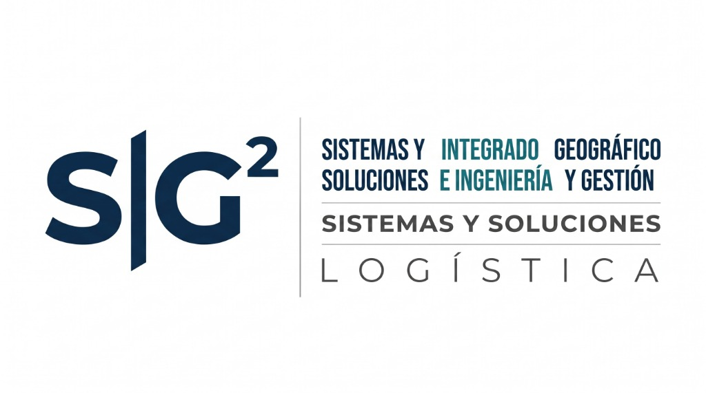

# SIG² | Plataforma Web Corporativa de Alta Ingeniería & Soluciones Digitales

Bienvenido al repositorio oficial del código fuente de la plataforma web corporativa de **SIG²** (*Sistemas y Soluciones | Integrado e Ingeniería | Geográfico y Gestión | Logística*).

- 🌐 **Enlace Público GitHub Pages:** [https://sig2ingenieria.github.io/ingenieria-sig/](https://sig2ingenieria.github.io/ingenieria-sig/)
- 📱 **Canal Directo WhatsApp:** [+57 312 789 4040](https://wa.me/573127894040)
- ✉️ **Bandeja Oficial CRM & Auditoría:** `ingenierotecnicocyc@gmail.com`

---

## 1. Identidad Visual Oficial

- **Paleta Cromática Extraída de la Marca:**
  - **Azul SIG (`#06466C` / `#04324E`)**: Solidez, autoridad institucional e ingeniería de clase mundial.
  - **Verde Teal (`#168F8A` / `#106E6A`)**: Innovación, precisión tecnológica y sustentabilidad ambiental.
  - **Gris Grafito (`#66696B`) & Gris Claro (`#9A9C9D`)**: Soporte tipográfico, líneas y mallas técnicas.
  - **Blanco Puro (`#FFFFFF`)**: Claridad ejecutiva y sobriedad.
- **Tipografía Unificada:** Arial (`Arial, 'Helvetica Neue', Helvetica, sans-serif`), números tabulares (`tabular-nums`) e iconografía vectorial SVG de alta definición.
- **Cero Precios Monetarios:** Enfoque 100% en cotización personalizada, consultoría técnica y demostraciones en faena.

---

## 2. Módulos y Soluciones Integradas

### 1. Soluciones Digitales & Apps
- **SIG Campo (Software Geotécnico & Perforación PWA):**
  - Registro digital de sondeos mecánicos a rotación y percusión (homologado bajo NSR-10 Título H / ASTM D1586).
  - Cálculo inmediato de resistencia a la penetración $N_{medido} = N_2 + N_3$ y corrección energética $N_{60}$.
  - Estratigrafía interactiva, control de nivel freático y exportación CSV compatible con Geo5, Slide2 y Plaxis.
- **SIG Fleet & PESV (App de Monitoreo de Flotas & Res. 40595 de 2022):**
  - Telemetría satelital en tiempo real con conmutación de capas: Satelital HD, Topografía LiDAR y Geocercas de Faena.
  - Inspección preoperacional digital para eliminar planillas de papel y control de fatiga ADAS.
- **Dashboards BI & Telemetría IoT:** Supervisión en vivo de piezómetros e inclinómetros digitales para alerta temprana en faenas.

### 2. CRM Corporativo & Pipeline Comercial (`#crm-hub`)
- **4 Cuadrantes de Atracción:** Minería & Obras Civiles (Clientes), Socios Estratégicos & Consorcios, Contratistas de Faena, y Cumplimiento Legal PESV/Ambiental.
- **Formulario de Calificación Rápida de Leads:** Captura de datos técnicos con persistencia en `localStorage`.
- **Tablero Ejecutivo con 4 KPIs Tabulares en Vivo:** Total Contactos, Clientes Calificados, Socios & Alianzas, y Propuestas Emitidas.
- **Directorio Interactivo de Leads:** Filtro por perfiles y actualización de estado en tiempo real (*Nuevo Lead, Calificado, Propuesta Emitida, En Negociación, Ganado*).
- **Mensajería Segmentada Automática:** Plantillas para Clientes, Socios y Contratistas con despacho directo a WhatsApp.
- **Automatización de Master Excel & Correo:**
  - Descarga instantánea de archivo `SIG2_CRM_Master_Leads_YYYY-MM-DD.csv` con codificación UTF-8 BOM para Microsoft Excel.
  - Despacho consolidado automático hacia **`ingenierotecnicocyc@gmail.com`**.

### 3. Agente Autónomo de Google Ads con IA (`#marketing-ia-ads`)
- **Administración Centralizada de Publicidad Digital:**
  - Panel integral de 8 KPIs: Inversión, Clics, Impresiones, CTR, CPC, Conversiones, CPL y control presupuestal diario/mensual.
  - **4 Categorías Comerciales Independientes:**
    1. *Seguridad y Salud en el Trabajo & PESV:* SG-SST, Asesorías, Res. 40595, HSEQ y Capacitaciones.
    2. *Ingeniería y Geotecnia:* Estudios de suelos NSR-10, Sondeos SPT, Tomografía eléctrica, Refracción sísmica, Geología e Instrumentación.
    3. *Consultoría Ambiental:* Estudios de impacto ambiental (EIA), Hidrología, Hidrogeología, PMA/ICA y Gestión de Riesgos.
    4. *Soluciones Digitales:* Desarrollo web para ingeniería, Automatización con IA, CRM y Telemetría.
- **Laboratorio IA de Keyword Research & Generador RSA:**
  - Clasificación semántica de intención de búsqueda (*Transaccional, Comercial B2B*).
  - Generador de anuncios RSA con 15 títulos y 4 descripciones bajo límites oficiales de caracteres.
  - Previsualizador interactivo idéntico a la SERP de Google Search.
  - Base de palabras clave negativas para blindaje presupuestal.
- **Sistema de Seguridad Tripartito:**
  - *Modo 1: Supervisado* (Aprobación humana obligatoria antes de publicar en Google Ads).
  - *Modo 2: Semiautomático* (Publicación y optimización dentro de límites estrictos autorizados).
  - *Modo 3: Autónomo* (Gestión continua de pujas y reasignación de saldo).
  - *Parada de Emergencia (Kill-Switch):* Detención instantánea en 1 clic de todas las automatizaciones.
- **Trazabilidad y Atribución al CRM:**
  - Registro de prospectos con atribución publicitaria (*Campaña, Palabra Clave detonante, UTM Source/Medium/Campaign y GCLID*).
  - Exportación directa de Master de Atribución en formato Excel con codificación UTF-8 BOM.
- **Persistencia y Backend Seguro:**
  - Esquema relacional PostgreSQL con RLS en [`supabase-schema.sql`](supabase-schema.sql) (13 tablas relacionales).
  - Proxy seguro para Edge Functions en [`google-ads-edge-proxy.js`](google-ads-edge-proxy.js) protegiendo el Developer Token y Client Secret fuera del frontend.

### 4. Macro-Plataforma CONSULTORA AI (`#consultora-ai`)
- **Departamento Digital Autónomo de Marketing, Prospección y Ventas:**
  - Panel unificado con 15 submódulos y 11 indicadores comerciales clave en tiempo real.
  - **4 Unidades Estratégicas de Negocio:** *Ingeniería y Geotecnia, SST y HSEQ, Consultoría Ambiental, Transformación Digital*.
  - **Motor de 7 Agentes de Inteligencia Artificial (OpenAI GPT-4o):**
    - *Agente 1:* Investigación de Mercado, Sectores & Competidores.
    - *Agente 2:* Prospección B2B en fuentes mercantiles públicas (RUES / SECOP II).
    - *Agente 3:* Estrategia de Marketing & Objetivos por Unidad.
    - *Agente 4:* Creador de Contenido (Posts LinkedIn, Carruseles, Guiones de Video, Artículos).
    - *Agente 5:* Administrador de Redes Sociales (LinkedIn, Instagram, Facebook) & Calendario.
    - *Agente 6:* Publicidad Digital (Google Ads API & Meta Marketing API).
    - *Agente 7:* Asistente Comercial (Atención inmediata y WhatsApp B2B).
  - **Centro de Aprobaciones Human-in-the-Loop:** Flujo de control con 7 estados (*Borrador, En revisión, Aprobado, Programado, Publicado, Rechazado, Error*).
  - **CRM Comercial Propio de 10 Etapas:** Pipeline Kanban visual desde *Empresa identificada* hasta *Cierre comercial*.
  - **Orquestación n8n:** 12 flujos automatizados especificados en [`n8n-workflows.json`](n8n-workflows.json).
  - **Base de Datos PostgreSQL (21 Tablas):** Esquema relacional completo con RLS en [`consultora-ai-schema.sql`](consultora-ai-schema.sql).
  - **Seguridad y Cumplimiento:** Ley 1581 de 2012 (Habeas Data Colombia) y aislamiento de claves en servidor.

### 5. Motor Autónomo de Búsqueda de Clientes & Publicidad Orgánica Propia (Cero Dependencias)
- **100% Nativo en el Navegador (Sin APIs de Pago Obligatorias):**
  - Opera sin necesidad de pagar OpenAI API, servidores n8n ni pauta publicitaria en Google Ads / Meta Ads.
- **Radar Autónomo de Búsqueda de Clientes B2B:**
  - Detección activa de licitaciones y proyectos reales en Colombia (Consorcios Viales 4G, Canteras, Flotas de Transporte, Constructoras).
  - Filtro interactivo por Sector y Región geográfica de Colombia.
  - Despacho inmediato en 1 clic:
    * *WhatsApp:* Pre-arma una propuesta técnica estructurada y abre el chat oficial con el cliente o al WhatsApp `+57 312 789 4040`.
    * *Correo:* Envía oferta formal con alcance técnico y copia oculta a `ingenierotecnicocyc@gmail.com`.
    * *CRM:* Importa instantáneamente el prospecto al Pipeline Kanban de 10 etapas.
- **Estudio de Publicidad Orgánica Inbound (100% Gratuito):**
  - **Artículos Técnicos SEO para Google Colombia:** Genera artículos exhaustivos (NSR-10, PESV Res. 40595, Geofísica, SG-SST) con datos estructurados `schema.org` (JSON-LD) listos para copiar e indexar gratis en Google.
  - **Carruseles B2B para LinkedIn:** 4 barajas técnicas de 5 láminas con visualizador interactivo y copy optimizado con hashtags de ingeniería.
  - **Guiones Directos para WhatsApp:** Modelos de contacto persuasivo para directores de obra, jefes de compras y gerentes HSEQ.
  - **Imanes de Leads Interactivos:**
    * *Calculadora Geotécnica NSR-10 (Título H.3):* Calcula sondeos mínimos obligatorios, profundidad y ensayos según categoría y área, con captura de leads.
    * *Diagnóstico PESV (Res. 40595 de 2022):* Calcula el nivel de diseño de flota (Básico, Estándar, Avanzado) y pasos obligatorios, vinculando al prospecto con el CRM.

### 6. Asistente Virtual Inteligente "Cadenero"
- Chatbot flotante especializado en captación y calificación de leads técnicos.
- Generación de expediente técnico CRM consolidado y transferencia directa a WhatsApp (+57 312 789 4040).

### 7. Alianza Estratégica en Sociedad con GESURA (Valle del Cauca)
- **Empresa Socia:** GESURA (*Gestión Segura del Trabajo*).
- **Cobertura Regional Prioritaria:** Valle del Cauca (Guadalajara de Buga como base operativa, Yotoco, Tuluá, Guacarí, San Pedro, El Cerrito, Palmira, Cali y Buenaventura).
- **División Operativa Especializada:**
  * **Operación Física y de Campo (GESURA):** Acompañamiento en sitio en Tareas de Alto Riesgo (TAR):
    - Trabajo Seguro en Alturas (Resolución 4272 de 2021) con coordinadores certificados y cuadrilla de rescate.
    - Ingreso a Espacios Confinados (Resolución 0491 de 2020) con vigías, equipos de ventilación y medición de gases.
    - Trabajos en Caliente (soldadura, oxicorte, amolado en atmósfera de riesgo).
    - Bloqueo y Etiquetado LOTO (energías peligrosas mecánicas, eléctricas e hidráulicas).
  * **Operación Virtual, Normativa y Software (SIG²):**
    - Aplicación de Batería de Instrumentos de Riesgo Psicosocial (Resolución 2764 de 2022 y Res. 2404 de 2019) con Psicólogo Especialista en SST con Licencia vigente.
    - Software digital para Plan Estratégico de Seguridad Vial PESV (Resolución 40595 de 2022).
    - Auditorías legales y diseño del SG-SST (Decreto 1072 de 2015 y Resolución 0312 de 2019).
- **Portafolio en Sociedad Interactivo:**
  * Modal multi-pestaña accesible desde la navegación principal (`#alianza-gesura`).
  * Calculador interactivo de Batería Psicosocial con cotización instantánea y sincronización al CRM.
  * Selector de despacho de cuadrilla física para faenas en el Valle del Cauca.

### 8. Máquina de Conversión Diaria ("Al menos 1 Cliente al Día")
- **Top Sticky Bar:** Barra superior fija con llamado a la acción directo a WhatsApp y correo oficial.
- **Cotizador Exprés en 30 Segundos:** Integrado directamente en el Hero Banner para reducir la fricción de entrada.
- **Protocolo de Prospección Diaria (5 Leads/Día):** Tablero operativo con 5 oportunidades de alta prioridad renovadas diariamente con plantilla de contacto a WhatsApp y registro instantáneo en CRM.
- **Prueba Social en Tiempo Real (Live Toast):** Notificaciones discretas en la esquina inferior que muestran empresas reales en Colombia cotizando servicios cada 24 segundos.
- **Captura por Intención de Salida (Exit-Intent Modal):** Detección de salida del cursor o 35 segundos de navegación con oferta de diagnóstico previo sin costo.

---

## 3. Despliegue en GitHub Pages

Este repositorio cuenta con un flujo de trabajo automatizado en `.github/workflows/deploy.yml` que compila y publica los activos estáticos (`index.html`, `styles.css`, `app.js`, `assets/`) en:
👉 **`https://sig2ingenieria.github.io/ingenieria-sig/`**

---

© 2026 SIG² Sistemas e Ingeniería. Todos los derechos reservados.
